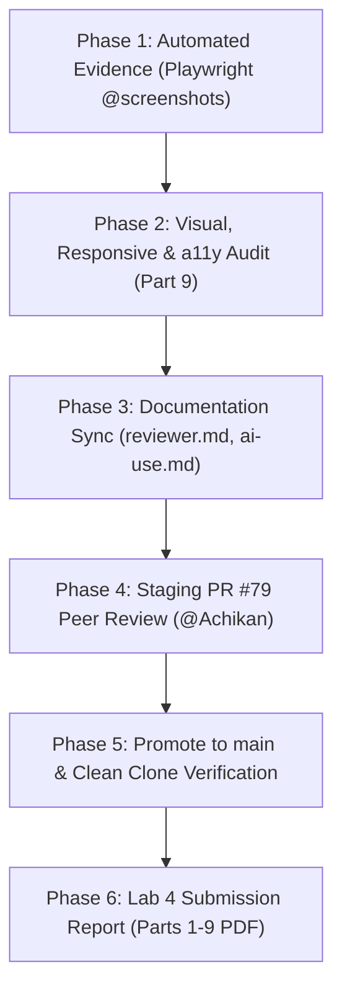

# Plan: Issue 11 — Visual, Responsive, and Accessibility Pass + Release Evidence

> **Context**: Lab 4 Sprint 4 final delivery.  
> **GitHub Issue**: [#68: Visual, Responsive, and Accessibility Pass + Release Evidence](https://github.com/il0lk3/TokTickIT/issues/68)  
> **Branch**: `feature/lab4-release-evidence` (branched off `origin/lab4-staging` commit `465c7b2`)  
> **Pull Request**: [#79: feat(lab4): issue 11 - visual, responsive, and accessibility pass + release evidence](https://github.com/il0lk3/TokTickIT/pull/79)  
> **Reviewer**: [@Achikan](https://github.com/Achikan) (Achiraya Inta)

---

## 1. Executive Summary & Root Cause Analysis of Image Bugs

### ปัญหาที่ 1: Modal Backdrop ไม่เบลอทั้งหมด (`08-close-confirm-dialog.png` และ Dialog อื่นๆ)
- **สาเหตุ**: การถ่ายภาพ Dialog เดิมใช้ `captureFullPage` (`fullPage: true`) ทำให้ Playwright จับภาพยาวทั้งหน้าเว็บ (สูง 9,836px) แต่ตัว `.modal` ใน CSS กำหนด `position: fixed; inset: 0` ซึ่งครอบคลุมเฉพาะขนาด Viewport (800px) เท่านั้น ทำให้มีเพียงส่วนบนที่มืด ส่วนด้านล่างที่เหลือกลายเป็นสีขาวหลุดกรอบ
- **การแก้ไข**:
  1. เพิ่มคลาส `glass-overlay` และ `backdropFilter: 'blur(8px)'` ใน [AccessibleDialog.tsx](../../client/src/components/common/AccessibleDialog.tsx) ให้เป็นเอฟเฟกต์กระจกฝ้า Zen Green
  2. สร้างฟังก์ชัน `captureModal(page, filePath)` ถ่ายภาพในระดับ Viewport (`fullPage: false`) ที่ขนาด 1280×800 (@2x = 2560×1600) ทำให้พื้นหลังเบลอและมืดคลุม 100% เต็มจอ และกล่อง Dialog อยู่กึ่งกลางอย่างพอดี

### ปัญหาที่ 2: Tab / Navbar ด้านบนเลื่อนตกลงมาประทับตรงกลางภาพ (`31-edit-validation-desktop.png`, `04-ticket-detail-attachments.png`)
- **สาเหตุ**: แท็ก Navbar มีคลาส `sticky-top` (`position: sticky; top: 0`) เมื่อ Playwright เลื่อนจอ (Scroll) เพื่อต่อภาพแบบ Full-page หรือเลื่อนไปยังส่วนตาราง ตัว Navbar จึงเลื่อนตามลงมาและถูกถ่ายซ้อนทับลงไปตรงกลางรูปภาพ
- **การแก้ไข**:
  1. เพิ่มฟังก์ชัน `disableStickyAndFloating(page)` ปลด `sticky-top` ให้เป็น `position: static !important` ชั่วคราวก่อนถ่ายภาพ ทำให้ Navbar อยู่ที่ด้านบนสุด (`y: 0`) เสมอ และไม่เลื่อนตามลงมาทับเนื้อหา
  2. ปรับ `31-edit-validation-desktop.png` ให้จับภาพเฉพาะแถว `[data-testid="inline-edit-form"]` โดยตรง ได้ภาพขนาดพอดี (2182×1594) เห็นกรอบแดงและข้อความเตือนอย่างชัดเจน ไม่ยาวผิดปกติ

---

## 2. แผนการดำเนินงานและสารบัญหลักฐาน (5 Execution Phases)



---

### Phase 1: Automated Screenshot Evidence (161 ภาพ ครบ 5 หมวดหมู่)

| โฟลเดอร์ | จำนวนภาพ | รายละเอียดหลักฐานตาม Labsheet |
|---|:---:|---|
| **`staff-dashboard/`** | 42 | ภาพรวม Desktop/Tablet/Mobile, 4 Metric Cards, Status/Priority Chips, Urgent & Recent Tickets, สิทธิ์ Admin vs Staff, Drill-down 6 คู่พร้อม Dynamic URL Banner, Loading Skeleton, Zero-state, 403 Forbidden, 500 Error Retry, Refresh สำเร็จ/ล้มเหลว, Keyboard Focus Ring, Mobile Nav และการเปรียบเทียบกับ Real PostgreSQL Raw Query |
| **`requester-dashboard/`** | 37 | ภาพรวม 3 จอ, 5 Requester Metric Cards, Needs Attention Panel, Empty State, Recent Activity, Requester Data Isolation (Bob vs Pueng), Drill-down 5 คู่, 403 Forbidden ข้ามตั๋ว/ข้ามคิว, Skeleton, Retry, Redirect Login, Refresh และการเปรียบเทียบกับ Real PostgreSQL Raw Query |
| **`actions-taken/`** | 47 | ภาพรวม 3 จอ, ตั๋วที่มีหลาย Actions จาก Staff 2 คน, รายละเอียดคอลัมน์ตาราง, Empty States, Requester Read-only (ซ่อนปุ่มเขียน 100%), Admin Controls, Non-owner logging (BR-02), Form ว่าง/กรอกแล้วข้าม 3 จอ, Client Validations 4 แบบข้าม 3 จอ, Submitting spinner, Server error data preservation, 403/Terminal lock, Inline edit/save/cancel/conflict 409 ข้าม 3 จอ, Tablet split layout, Keyboard focus |
| **`ticket-workflow/`** | 27 | มอบหมาย Owner สำเร็จข้าม 3 จอ (รวม Mobile บน/ล่าง), ปฏิเสธ Assign ผู้ใช้ Inactive/ผิด Role, Dropdown สถานะตาม Role (New/InProgress/Resolved) ข้าม 3 จอ, ซ่อนสิทธิ์ Requester, Resolution Gate ถูกบล็อกพร้อมปุ่มลัด, Resolve สำเร็จข้าม 3 จอ, Dialog ยืนยัน Cancel/Close, สถานะ Terminal Locked ข้าม 3 จอ, Concurrency Conflict 409, Requester Advisory button & Dialog, Staff Advisory Banner, และ Audit Log Proof |
| **`regression/`** | 8 | ตรวจสอบ Labs 1–3: หน้าจอ Login, My Tickets, Public Comments, File Attachments, Staff Internal Notes, Requester ซ่อน Internal Notes, Admin User Management, และ Admin ปิดปุ่ม Deactivate ตัวเอง |

---

### Phase 2: Zen Green Visual, Responsive & Accessibility Verification (Part 9)
- [x] **Visual Consistency**: ใช้พาเลตสี Zen Green (`#1b4332`, `#2d6a4f`, `#f4f9f5`), Typography และ Spacing สม่ำเสมอทุกหน้าจอ
- [x] **Color Independence**: สถานะและแท็กมีทั้งสี ไอคอน และข้อความกำกับเด่นชัด
- [x] **Responsive**: รองรับ 3 Breakpoints (Desktop 1280px, Tablet 768px, Mobile 375px) โดยไม่มี Horizontal Scrollbar
- [x] **Accessibility (WCAG 2.1 AA)**: 
  - Visible Focus Ring (`2px solid #2d6a4f`)
  - คีย์บอร์ดควบคุมได้ 100% (Tab, Shift+Tab, Esc ปิด Modal)
  - Accessible Dialog มี Focus Trap และคืนค่า Focus สู่ปุ่มเดิมเมื่อปิด
  - บันทึก Checklist ครบ 7 หัวข้อใน [ui-spec.md](./ui-spec.md)

---

### Phase 3: Documentation & Traceability Alignment
- [x] อัปเดต [reviewer.md](./reviewer.md): บันทึก PR #78 เป็น Approved & Merged และเพิ่มตาราง PR #79 สำหรับ Issue 11
- [x] อัปเดต [ai-use.md](./ai-use.md): บันทึกการใช้งาน AI ในการออกแบบสคริปต์สแนปช็อตอัตโนมัติ (จำนวน 10 รายการตรงตาม Rubric)
- [x] ตรวจสอบ `node scripts/verify-traceability.js`: ผ่าน 100% (0 undefined AC, 0 missing tests)
- [x] ตรวจสอบโครงสร้างโฟลเดอร์ให้ตรงกับ Labsheet ข้อ 12 (`docs/lab-04`, `server/tests/lab-04`, `e2e/lab-04`, `artifacts/lab-04`)

---

### Phase 4: Staging PR & Peer Review (@Achikan)
- **Branch**: `feature/lab4-release-evidence`
- **Target**: `lab4-staging`
- **PR**: [#79: feat(lab4): issue 11 - visual, responsive, and accessibility pass + release evidence](https://github.com/il0lk3/TokTickIT/pull/79)
- **ขั้นตอนถัดไป**:
  1. ให้เพื่อน (@Achikan) ตรวจสอบความถูกต้องของ PR #79
  2. เมื่อได้รับ Approval ทำการ Merge PR #79 เข้า `lab4-staging`

---

### Phase 5: Promotion to `main` & Clean Clone Verification
1. เปิด Release PR จาก `lab4-staging` เข้า `main` หรือ Fast-forward merge
2. ทำ Clean Clone Verification บนเครื่องสะอาด / โฟลเดอร์ใหม่:
   ```bash
   git clone https://github.com/il0lk3/TokTickIT.git toktickit-clean
   cd toktickit-clean
   npm run setup
   npm run prisma:migrate
   npm run prisma:seed
   npm run test:all
   ```
3. บันทึกประวัติ `git log --graph --oneline` เพื่อเป็นหลักฐาน Git Flow (Part 1)

---

### Phase 6: Lab 4 Submission Report Preparation (PDF Parts 1–9)
รวบรวมหลักฐานใส่รายงานส่งตามโครงสร้าง Rubric:
- **Part 1**: Git Workflow & Branching (PRs, Commit Graph, Peer Review Record)
- **Part 2**: Specification-Driven Development (`specification.md`, `api-spec.md`, `ui-spec.md`)
- **Part 3**: Test-Driven Development & Evidence (Unit, API, Component, E2E ผ่าน 100%)
- **Part 4**: AI Use Log & Reflection (`ai-use.md`, Selected Prompts)
- **Part 5**: IT Staff Dashboard (ภาพ 3 Breakpoints, Metric Cards, Drill-downs)
- **Part 6**: Actions Taken Feature & Concurrency (ภาพตาราง Actions, Form, Validations, 409 Conflict)
- **Part 7**: Ticket Workflow State Transitions & Gating (ภาพ Transition Matrix, Gate, Confirmation Dialogs)
- **Part 8**: Requester Dashboard & Data Isolation (ภาพ 5 Cards, Drill-downs, Bob vs Pueng, SQL Equivalence)
- **Part 9**: Visual Polish, Responsive Design & Accessibility (Checklist, Focus Ring, Mobile Layouts)

---

## 3. Definition of Done (DoD) Checklist

- [x] แก้ไขบั๊ก Modal Backdrop ไม่เบลอทั้งหมด
- [x] แก้ไขบั๊ก Tab/Navbar เลื่อนประทับตรงกลางภาพ
- [x] ถ่ายภาพหลักฐานครบ 161 ภาพ ใน `artifacts/lab-04/screenshots/`
- [x] ชุดทดสอบ `e2e/lab-04/screenshots.spec.ts` รันผ่านครบ 5/5
- [x] แก้ไขชื่อ PR #79 ให้ตรงตามแพทเทิร์น `feat(lab4): issue 11 - ...`
- [ ] ผู้ใช้ตรวจทาน Plan นี้และกด **Proceed** เพื่อรับรองความถูกต้อง
- [ ] เพื่อน (@Achikan) ตรวจสอบและกด Approve PR #79
- [ ] Merge PR #79 เข้า `lab4-staging`
- [ ] รวม `lab4-staging` เข้า `main` และรัน Clean Clone Verification
- [ ] รวบรวมเอกสารส่ง Final Submission PDF ครบ Part 1 - Part 9
